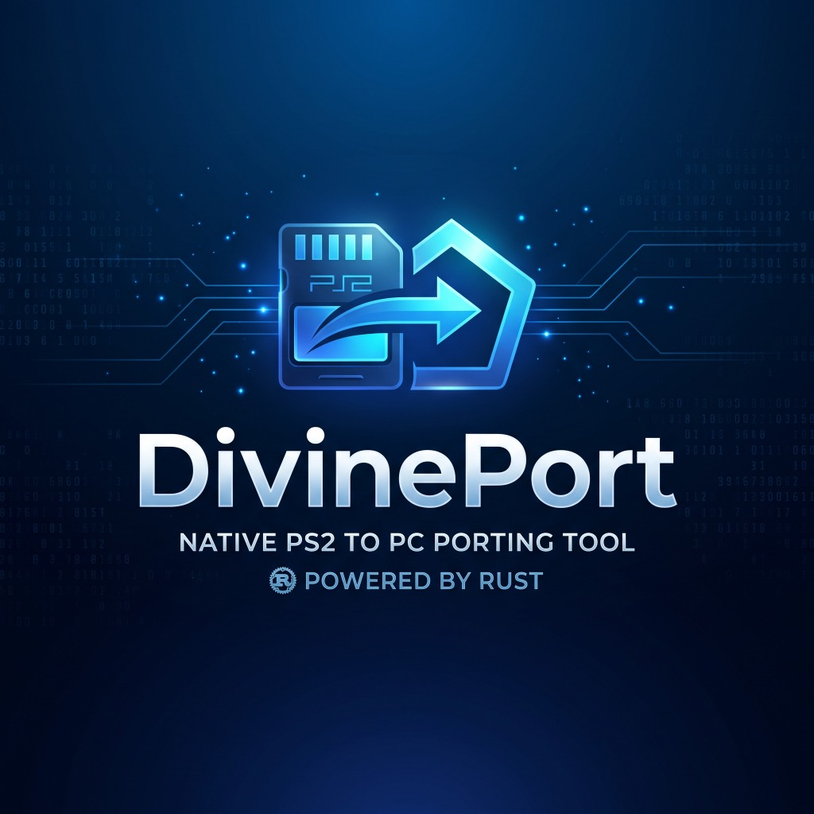

# DivinePort

<p align="center">
  
</p>

<p align="center">
  <strong>Native PS2 to PC Porting Tool & Launcher | Powered by Rust</strong>
</p>

---

**DivinePort** is a high-performance native frontend, launcher, and pipeline orchestrator for **PlayStation 2 Static Recompilation (AOT)**. Built entirely in **Rust** (`eframe`/`egui`), DivinePort fuses the technical desktop precision of **PCSX2** with the cutting-edge graphics and upscaling architecture of **SpartanPort (v2.2.0)**.

Unlike traditional PS2 emulators that rely on runtime JIT interpretation, games processed through DivinePort are translated ahead-of-time (AOT) from raw MIPS R5900 machine code directly into clean C++20 and compiled into standalone, native Windows `x86_64` executables (`ps2run.exe`).

---

## Architectural Highlights

### 1. Unified PCSX2 x SpartanPort Interface
- **PCSX2 Classic Desktop Menu Bar:** System (`Start Disc`, `Open ISO`, `Exit`), CDVD (`Scan Directory`, `Open games/`), Config (`Graphics`, `Controllers`, `General`), View (`Table List`, `Card Grid`, `Fullscreen`), Tools (`AOT Build Terminal`, `Clear Logs`), and Help (`Hotkeys`, `About`).
- **Iconic PCSX2 Multi-Column Table List:** Displays Title, Serial / ELF ID (`SLUS-20964`, `SLES-54490`), Region (`NTSC-U`, `PAL-E`), Disc Format, Recompilation Status, Widescreen PNACH Status, and 1-Click Launch/Recompile actions.
- **Search & Filter:** Real-time search filter for game titles and serial codes.
- **Iconic PCSX2 Status Bar:** Displays total registered games, active gamepads, engine compiler info (`LLVM MinGW Clang 23.1 AOT`), graphics backend (`WebGPU / Vulkan Core`), and target framerate (`60.00 FPS (100.0%)`).
- **Clean Technical Aesthetics:** Zero cartoon emojis. Pure technical monospace labels, crisp ASCII indicators, and dark graphite styling (`#0d1117`).

### 2. Temporal Upscaling & FidelityFX Pipeline (SpartanPort v2.2.0 Architecture)
- **AMD FidelityFX Super Resolution (FSR 3.1):** Universal multi-frame temporal upscaling compatible with all GPUs (NVIDIA GTX/RTX, AMD Radeon, Intel Arc & integrated GPUs).
- **FSR 3.1 Native HUD & Text (`fsr3ui`):** Retains 1080p native sharpness on 2D subtitles, loading screens, and HUD elements without spatial stretch.
- **AMD FSR 4:** Open-source AI reconstruction model for AMD Radeon RX 6000+ and Intel Arc GPUs.
- **AMD FSR 4.1:** Direct driver integration via AMD Vulkan runtime (`amdvkffx64.dll` Adrenalin 26.10.1+), with graceful fallback to FSR 3.1 on other hardware.
- **NVIDIA DLSS (Deep Learning Super Sampling):** Tensor Core AI reconstruction profile for GeForce RTX hardware.
- **Native Resolution TAA:** Temporal Anti-Aliasing at 100% resolution with jittering, reprojection, and depth rejection for razor-sharp edge smoothing without upscaling overhead.
- **Quality Presets with Dynamic Output Calculation:**
  - `Native AA` (100%)
  - `Ultra Quality` (77% internal render)
  - `Quality` (67% internal render)
  - `Balanced` (59% internal render)
  - `Performance` (50% internal render)
  - `Ultra Performance` (33% internal render)
- **AMD FSR & DLSS Frame Generation (2x):** Interpolates 1 extra frame between game renders, boosting 60 FPS gameplay to 120 FPS.
- **RCAS Sharpening:** Robust Contrast Adaptive Sharpening slider (0.00 to 1.00) for edge definition.
- **Spartan Memory & Stream Buffer:** Choose between `System RAM (Cached)`, `System RAM (Uncached)`, and `GPU Dedicated Memory`, alongside automatic MSAA black-line mitigation for AMD RX 6600 & Intel Arc.

### 3. Controller Layouts & In-Game Glyphs
- **Dynamic Glyph Prompt Engine:**
  - `Auto`: Automatically detects your controller (Xbox XInput vs DualShock/DualSense vs Switch).
  - `PlayStation`: Displays canonical PlayStation glyphs (`[X]`, `[O]`, `[Square]`, `[Triangle]`) with official Sony colors (Blue, Red, Pink, Green).
  - `Xbox`: Displays Xbox glyphs (`[A]`, `[B]`, `[X]`, `[Y]`) with Microsoft colors (Green, Red, Blue, Yellow).
  - `Nintendo`: Displays Switch Pro layout (`[B]`, `[A]`, `[Y]`, `[X]`).
  - `Keyboard & Mouse`: Displays PC keyboard keybindings.
- **Authentic Bitmask Integrity:** In-game functional logic always receives 100% authentic PS2 DualShock 2 bitmasks, preserving all combos and pressure sensitivity behaviors.
- **Interactive 2D Gamepad Canvas:** Real-time visualizer showing analog stick displacement and live button press feedback via `gilrs`.

### 4. Universal ROM Normalizer (5450+ PS2 Games Supported)
- Automatically normalizes all ROM naming conventions from internet dumps:
  - Colons (`:`) and semicolons (`;`)
  - Hyphens (`-`), en-dashes (`–`), em-dashes (`—`), and underscores (`_`)
  - Apostrophes (`'`), curly quotes (`’`), and backticks (`` ` ``)
  - Ampersands (`&`), plus signs (`+`), commas, and region tags (`(USA)`, `[SLUS-...]`, `(Europe)`)
- Direct invocation of the portable MinGit bash and Python toolchain prevents PowerShell quote-parsing errors.
- Automatically fetches and injects widescreen 16:9 PNACH patches from PCSX2's official patch database during compilation.

---

## In-Game Keyboard & Controller Shortcuts

| Input | Action |
| :--- | :--- |
| `F11` | Toggle Borderless Fullscreen (removes window borders and taskbar) |
| `F2` | Cycle Picture Filter Look (`Crisp`, `Soft`, `Sharp`, `Bilinear`) |
| `Insert` / `R3 + L2` | Open In-Game Configuration Menu (Display, Upscaler, Audio) |
| `F5` / `F8` | Save State / Load State |
| `Esc` | Open In-Game Pause Menu / Release Mouse Pointer |

---

## Getting Started

### Prerequisites
- Windows 10/11 (64-bit)
- Rust toolchain (`cargo` & `rustc`)
- A clone of `ps2-native-recomp` in the parent or adjacent folder

### Running the Prebuilt Binary
Run `DivinePort.exe` directly or double-click `Launch.cmd`.

### Building from Source
```bash
git clone https://github.com/ahkurdev/DivinePort.git
cd DivinePort
cargo run --release
```

The optimized standalone binary will be generated at `target/release/DivinePort.exe`.

---

## Configuration Files
- `settings.json`: Stores frontend preferences (GUI scale, language, controller glyphs, Discord RPC).
- `spartanport.ini` / `recomp.ini`: Engine runtime configuration written into each game's folder (render scale, upscaler, preset, frame generation, stream memory, MSAA).

---

## License

DivinePort is dual-licensed under:
- **MIT License** ([LICENSE-MIT](LICENSE-MIT))
- **GNU General Public License v3.0 or later** ([LICENSE-GPL](LICENSE-GPL))

SPDX-License-Identifier: `MIT OR GPL-3.0-or-later`

Developed with passion by **ahkurdev**.
